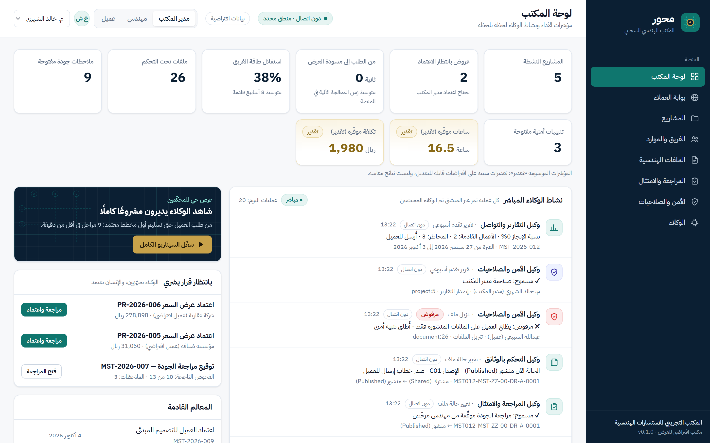
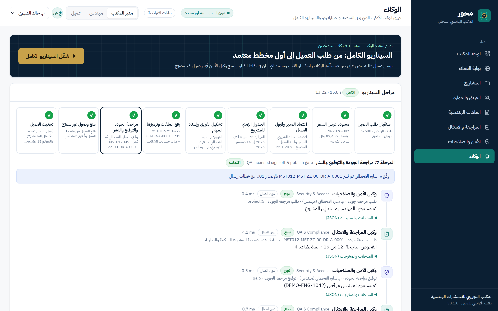
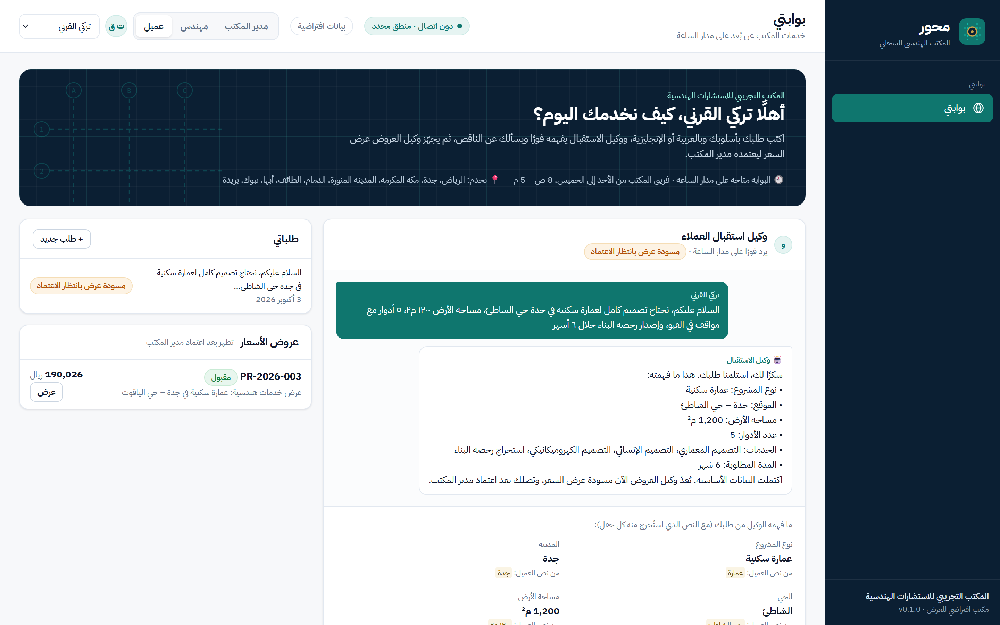
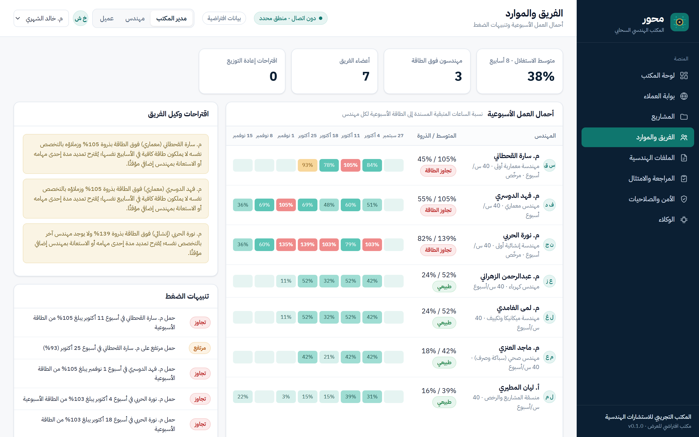

# محور | Mihwar

**المكتب الهندسي السحابي.. يديره فريق من وكلاء الذكاء الاصطناعي**
*An AI-run cloud platform for engineering offices: an orchestrator plus 8 specialist AI agents run every operation.*

نموذج أولي (Prototype) للمشاركة في **الهاكاثون الهندسي — IECE 2026**، المسار الثاني «التطوير الهندسي»، تحدي «المكاتب الهندسية السحابية».

> ⚠️ **بيانات افتراضية:** المكتب («المكتب التجريبي للاستشارات الهندسية») والعملاء والمشاريع والأسماء غير حقيقية. قيم الاشتراطات والأتعاب والمدد و«الساعات الموفّرة» **قيم توضيحية قابلة للتعديل**، وليست قيم كود البناء السعودي الرسمية ولا نتائج مقاسة.

| لوحة المكتب · Dashboard | الوكلاء · Agents |
|---|---|
|  |  |
| **بوابة العميل · Client portal** | **الفريق والموارد · Team** |
|  |  |

More screenshots in [docs/screenshots](docs/screenshots).

---

## بالعربية

### ما هو محور؟
منصة واحدة تمكّن المكتب الهندسي من **تقديم خدماته عن بُعد، وإدارة مشاريعه وفرقه وملفاته الهندسية في بيئة موحدة وآمنة**. كل عملية في المنصة حدثٌ يستقبله **المنسّق** ويمرّره على الوكلاء المختصين بالترتيب، ويسجّل كل خطوة:

| # | الوكيل | ماذا يفعل |
|---|---|---|
| 0 | المنسّق | يوجّه كل حدث للوكلاء المناسبين ويسجّل سجل التتبّع ويعالج الأعطال |
| 1 | وكيل استقبال العملاء | يفهم طلب العميل المكتوب (عربي/إنجليزي، أرقام هندية، لهجة) ويستخرج بيانات المشروع ويسأل عن الناقص |
| 2 | وكيل العروض والتسعير | يجهّز نطاق الخدمات والأتعاب والضريبة والدفعات، وينتظر اعتماد المدير |
| 3 | وكيل تخطيط المشاريع | يبني المراحل والمهام والجدول الزمني (الأحد–الخميس) |
| 4 | وكيل الفريق والموارد | يسند المهام حسب التخصص والطاقة وينبّه عند الضغط ويقترح إعادة التوزيع |
| 5 | وكيل التحكم بالوثائق | يصنّف الملف ويرمّزه (منهجية مستوحاة من ISO 19650) ويدير الإصدارات والحالات |
| 6 | وكيل المراجعة والامتثال | يفحص بيانات المشروع واكتمال المخرجات ويشترط توقيع مهندس مرخّص قبل النشر |
| 7 | وكيل الأمن والصلاحيات | يتحقق من صلاحية كل عملية ويسجّلها ويكشف السلوك غير المعتاد |
| 8 | وكيل التقارير والتواصل | يكتب تقارير التقدم ويجيب أسئلة العملاء من بيانات المشروع ويحسب المؤشرات |

التفاصيل الكاملة لكل وكيل في [AGENTS.md](AGENTS.md)، والبنية في [docs/architecture.md](docs/architecture.md).

### التشغيل على ويندوز (خطوة واحدة)
1. ثبّت **Python 3.10 أو أحدث** من python.org (فعّل خيار *Add python.exe to PATH*).
2. افتح مجلد `Mihwar` واضغط مرتين على **`run.bat`**.
   - أول مرة: ينشئ بيئة `.venv` ويثبّت المتطلبات (يحتاج إنترنت، حوالي دقيقة).
   - يفتح المتصفح تلقائيًا على `http://127.0.0.1:8090`.
3. بدّل الأدوار من الشريط العلوي: **مدير المكتب / مهندس / عميل**.
4. للعرض أمام المحكّمين: صفحة **«الوكلاء»** ← زر **«شغّل السيناريو الكامل»** (9 مراحل في نحو 16 ثانية).

> لإعادة البيانات إلى حالتها الأولى: احذف مجلد `var` وأعد التشغيل.

### الاختبارات
اضغط مرتين على **`test.bat`**، أو:
```bat
.venv\Scripts\python -m pytest -q             :: 87 اختبارًا آليًا
.venv\Scripts\python -m mihwar.healthcheck -v :: الاختبار الذاتي لكل وكيل (65 فحصًا)
.venv\Scripts\python scripts\smoke_ui.py      :: 16 فحصًا للواجهة عبر الأدوار الثلاثة في Edge
```
النتائج الفعلية موثقة في [docs/test-report.md](docs/test-report.md).

### الوضعان
- **دون اتصال (الافتراضي):** منطق محدد مسبقًا (قواعد، استخراج بالأنماط، قوالب). كل العرض وكل الاختبارات تعمل **دون إنترنت ودون مفتاح**.
- **وضع Claude (اختياري):** انسخ `.env.example` إلى `.env` واكتب `MIHWAR_LLM=on` ومفتاحك في `ANTHROPIC_API_KEY`. عندها يستخدم وكلاء الاستقبال والوثائق والتقارير نموذج `claude-opus-5-5` لفهم النص العربي الحر وكتابة الردود، بمخرجات JSON مُتحقق منها، مع **رجوع تلقائي** للوضع دون اتصال عند أي خطأ (يظهر في سجل التتبّع كـ «رجوع تلقائي»). فعّلنا خاصية `fallbacks` الخاصة بـ Anthropic لإعادة الطلب تلقائيًا على نموذج بديل عند الرفض.

### حدود النموذج الأولي
- الهويات تجريبية (تبديل أدوار) دون تسجيل دخول حقيقي.
- قواعد الامتثال توضيحية ولا تقرأ المخططات نفسها؛ تفحص بيانات المشروع وبيانات الملفات.
- قاعدة البيانات SQLite محلية؛ الإطلاق الفعلي يتطلب PostgreSQL واستضافة سحابية داخل المملكة.
- حالة السداد الفعلية غير مربوطة؛ تُعرض جدولة الدفعات فقط.

---

## English

> **Status:** hackathon prototype (IECE 2026 Engineering Hackathon entry), runs locally, not deployed.
> **Fictional data:** the office («المكتب التجريبي للاستشارات الهندسية»), clients, projects and people are invented. Rule values, fees, durations and "hours saved" are illustrative, editable values, not official Saudi Building Code values or measured results.

### What it is
A working prototype of an AI-run cloud office for engineering firms: a client portal (24/7 Arabic/English intake), proposals with manager approval, automatic project planning, team assignment with workload alerts, ISO 19650-inspired document control with a QA gate, an editable compliance rule pack with licensed-engineer sign-off, role-based security with audit log and anomaly alerts, and client reporting. Every action is an event routed by an **orchestrator** through **8 specialist agents**; every step is traced and visible in the UI.

### Run (Windows)
Install Python 3.10+, then double-click **`run.bat`** (creates `.venv`, installs pinned requirements, starts the server, opens `http://127.0.0.1:8090`). Switch roles in the top bar. For the judges: **Agents → "Run the full scenario"**.

Manual: `python -m venv .venv` → `.venv\Scripts\pip install -r requirements.txt` → `.venv\Scripts\python -m mihwar`.

### Tests
`test.bat`, or `pytest -q` (87 tests), `python -m mihwar.healthcheck -v` (every agent's self-test, 65 checks), `python scripts/smoke_ui.py` (16 page-and-role checks in headless Edge). Real outputs: [docs/test-report.md](docs/test-report.md). Regenerate the deck screenshots with `python scripts/make_screenshots.py`.

### Modes
Offline deterministic mode is the default (no internet, no key). Optional Claude mode: `MIHWAR_LLM=on` + `ANTHROPIC_API_KEY` in `.env` (never in code). Intake, document classification and reporting then call `claude-opus-5-5` (low effort, JSON-schema structured output, server-side refusal `fallbacks`) and fall back to offline logic on any error, refusal or timeout.

### Project layout
```
Mihwar/
  run.bat · test.bat · requirements.txt · .env.example
  mihwar/            Python package (FastAPI app, orchestrator, agents, seed, scenario)
    agents/          the 8 specialist agents
    data/            editable JSON config: price list, rule pack, phase templates, assumptions, office
    web/             Arabic RTL single-page app (plain HTML/CSS/JS, no build step, font vendored)
  tests/             pytest suite
  scripts/           screenshots + UI smoke test (headless Edge)
  docs/              architecture, API contract, test report, screenshots
```

### Credits
Built for Yazeed Almutrif's IECE 2026 hackathon entry. Font: IBM Plex Sans Arabic (SIL Open Font License, see `mihwar/web/assets/fonts/OFL-LICENSE.txt`).
