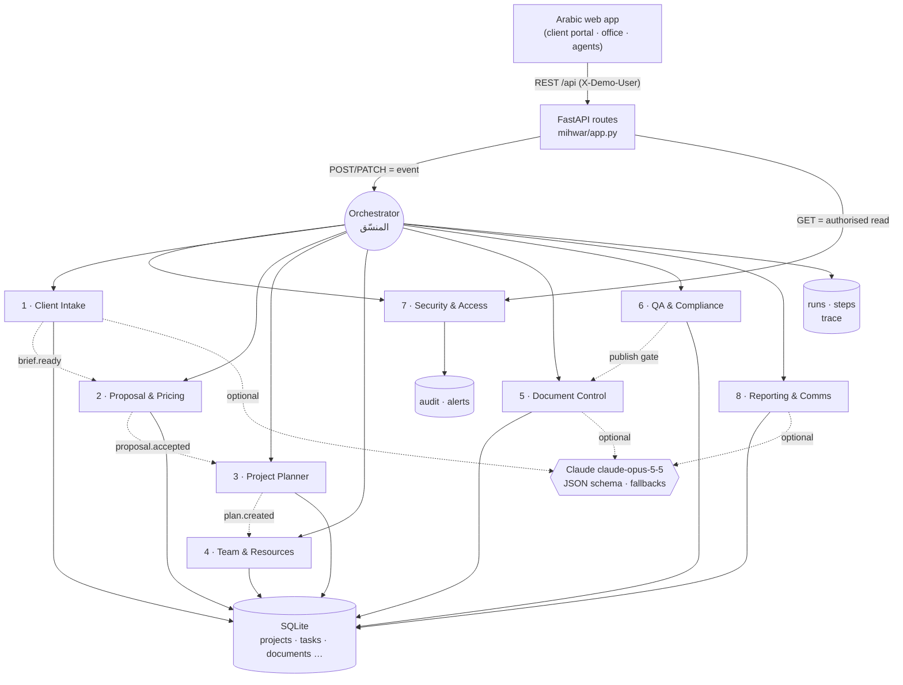
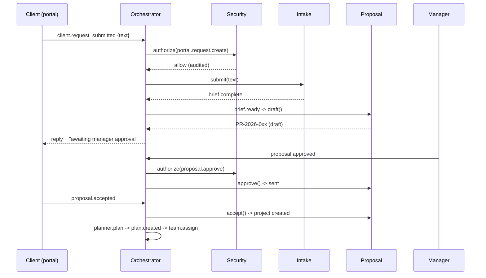

# Mihwar architecture

## Agent graph

Every website action becomes an event. The orchestrator routes it through the agents declared in `ROUTES`
(`mihwar/orchestrator.py`); the Security agent always runs first for actions a person takes.

## Request flow (example: a client submits a request)

## Human in the loop

| Decision | Who | Enforced by |
|---|---|---|
| Send a proposal to the client | Office manager | Proposal agent state machine + Security (`proposal.approve`) |
| Publish a file to the client | Licensed engineer signs the QA report | Compliance gate + Document Control (`qa_signoff_required`) |
| Reassign a task | Office manager | Security (`team.rebalance`) |
| Any engineering approval/stamp | Licensed engineer, outside the platform | The platform never approves designs on its own |

## Modes

| | Offline (default) | Claude (optional) |
|---|---|---|
| Intake | regex + keyword extraction with evidence | structured JSON extraction, merged and validated |
| Document Control | filename rules | consulted only when confidence < 0.6 |
| Reporting | templates from project data | rewording of the same facts; rejected if a figure is lost |
| On error | n/a | automatic fallback, traced as `offline-fallback` |

## Main data

`users`, `clients`, `requests`, `messages`, `proposals`, `projects`, `project_members`, `tasks`, `documents`,
`transmittals`, `qa_reports`, `reports`, `audit`, `alerts`, `runs`, `steps`, `selftests` (SQLite, `var/mihwar.db`).

Editable configuration (illustrative values): `mihwar/data/price_list.json`, `rule_pack.json`, `phase_templates.json`,
`assumptions.json`, `office.json`.

## Path to production (after the hackathon)

PostgreSQL + object storage for files · real authentication (SSO / national identity provider) and per-office tenancy ·
hosting inside Saudi Arabia · rule packs authored with licensed engineers from the official Saudi Building Code and
municipal requirements · a drawing viewer (PDF/IFC) · integrations with the office's existing tools.
